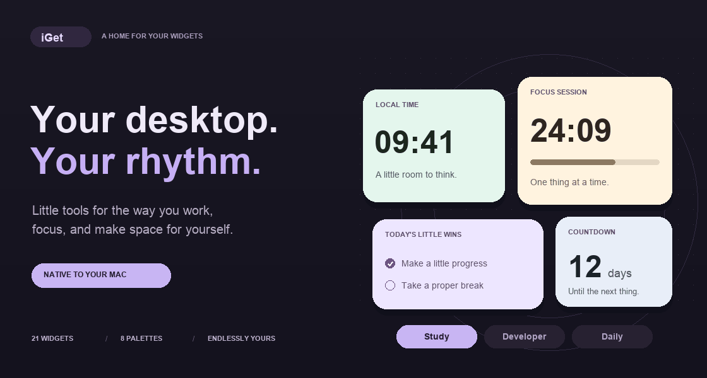

<div align="center">
  
  <h1>iGet</h1>
  <p><strong>A little more you. A little less ordinary.</strong></p>
  <p>Native desktop widgets and personal workspaces for macOS.</p>
  <p>
    
    
    
    <a href="LICENSE"></a>
  </p>
  <p>
    <a href="#see-it-in-action">See it in action</a> &nbsp;·&nbsp;
    <a href="#make-it-yours">Make it yours</a> &nbsp;·&nbsp;
    <a href="#find-your-space">Spaces</a> &nbsp;·&nbsp;
    <a href="#get-started">Get started</a>
  </p>
</div>

<p align="center">
  
  <br />
  <sub>Three ways to settle in. One desktop that feels like yours. · <a href="assets/readme/hero.png">View without animation</a></sub>
</p>

## Small tools. A better place to spend your day.

Keep your next task, a focus session, a favorite photo, and the little things you check all day right on your desktop. Arrange them your way, give them a palette you love, and save a different layout for whatever comes next.

<table>
  <tr>
    <td align="center" width="25%"><h3>21</h3>desktop widgets</td>
    <td align="center" width="25%"><h3>8</h3>matte palettes</td>
    <td align="center" width="25%"><h3>3</h3>curated Spaces</td>
    <td align="center" width="25%"><h3>EN · TR · DE</h3>interface languages</td>
  </tr>
</table>

## See it in action

From the widget library to your desktop: pick a widget, make it your own in Studio, and find a spot for it.

<p align="center">
  
  <br />
  <sub>The native macOS application in action.</sub>
</p>

## Make it yours

<table>
  <tr>
    <td width="50%" valign="top">
      <h3>A style for every little thing</h3>
      <p>Fine-tune size, typography, opacity, corners, borders, and solid, glass, or transparent surfaces in <strong>Widget Studio</strong>.</p>
      <p>Choose Sage, Paper, Lilac, Slate, Aurora, Peach, Sky, or Rose. Bring your own hex colors when you want something different.</p>
    </td>
    <td width="50%" valign="top">
      <h3>Space to make something personal</h3>
      <p>Build a <strong>custom canvas</strong> with movable text, symbols, time, date, and progress layers.</p>
      <p>Connect progress to your tasks, focus sessions, habits, or daily water count.</p>
    </td>
  </tr>
  <tr>
    <td width="50%" valign="top">
      <h3>Right where you want it</h3>
      <p>Place widgets at desktop level, alongside your windows, or floating above them. Lock positions, snap to an 8 pt grid, or enable click-through.</p>
    </td>
    <td width="50%" valign="top">
      <h3>A layout worth keeping</h3>
      <p>Save arrangements as <strong>Spaces</strong>, switch from the app or menu bar, and share schema-validated <code>.iget.json</code> packs. Back up and restore your workspace with JSON.</p>
    </td>
  </tr>
</table>

## Find your Space

A quiet study session, a workday at your editor, or a little everyday order. Start with a curated layout and make it your own.

| Study | Developer | Daily |
| :--- | :--- | :--- |
| **Room to concentrate.** | **Keep the useful things close.** | **A little everyday rhythm.** |
| Clock · Focus · Tasks · Countdown | System monitor · Notes · Shortcuts | Calendar · Weather · Battery · Habits |

Create custom Spaces for everything in between. Spaces control iGet desktop widgets; widgets placed through macOS keep their system-managed positions.

## Pick your little essentials

| For… | Add these widgets |
| :--- | :--- |
| **Getting things done** | Tasks, Notes, Habits, Water tracker, Breathing timer |
| **Keeping your rhythm** | Clock, Focus timer, Calendar, Countdown |
| **Making it personal** | Custom canvas, Photo, Quote |
| **Staying connected** | Weather, Music, Shortcuts, Battery, System monitor |
| **A well-earned distraction** | Pocket pet, Sticker, Dice, Noughts & crosses |

Seven local tools also have system widgets through the companion `iGetWidgets` WidgetKit extension.

## Native by design

- **SwiftUI + AppKit.** No embedded web views or third-party runtime dependencies.
- **Local workspace.** Notes, tasks, images, and layouts are stored in SQLite on your Mac.
- **Demand-driven updates.** CPU, memory, and battery sampling stop when no matching widget or editor needs them, and pause on sleep.
- **Connections you choose.** Weather uses Open-Meteo with a 15-minute cache. Apple Music and Spotify playback controls require explicit opt-in and macOS Automation permission.
- **Three languages.** English, Turkish, and German, with localized dates and number formatting.

## Get started

Requires **macOS 14 or later**. The standalone app supports **Apple Silicon** and **Intel**.

### Build on your Mac

Install [Apple Command Line Tools](https://developer.apple.com/xcode/resources/) if needed:

```sh
xcode-select --install
```

Then clone and build:

```sh
git clone https://github.com/TwoBit-Dev/iGet.git
cd iGet
make local
open build/iGet.app
```

### Standalone archives

Check [GitHub Releases](https://github.com/TwoBit-Dev/iGet/releases) for published downloads. You can also produce both architecture archives locally with `make packages`:

| Your Mac | Archive produced in `build/releases/` |
| :--- | :--- |
| Apple Silicon (`arm64`) | `iGet-0.3.0-apple-silicon.zip` |
| Intel (`x86_64`) | `iGet-0.3.0-intel.zip` |

For a downloaded archive, compare its SHA-256 checksum with `SHA256SUMS.txt`, extract `iGet.app`, and move it to `/Applications`.

<details>
<summary><strong>Opening an ad hoc signed build for the first time</strong></summary>

Standalone archives are ad hoc signed rather than notarized with an Apple Developer ID certificate. If Gatekeeper blocks the first launch, Control-click `iGet.app` in Finder and choose **Open**. For a trusted download, you can also remove its quarantine attribute:

```sh
xattr -cr /Applications/iGet.app
open /Applications/iGet.app
```

</details>

<details>
<summary><strong>Installing the companion macOS system widgets</strong></summary>

Building and installing the `iGetWidgets` WidgetKit extension requires full Xcode, a signing team, and the `group.com.twobitdev.iGet` App Group capability configured for both targets. See the [development guide](docs/DEVELOPMENT.md).

</details>

## Under the hood

| Explore | What you'll find |
| :--- | :--- |
| [Development](docs/DEVELOPMENT.md) | Architecture, builds, storage, personalization, and resource policy |
| [Connected services](docs/INTEGRATIONS.md) | Weather, music permissions, photos, and launchers |
| [Validation record](docs/VALIDATION.md) | Recorded checks, render coverage, and remaining device checks |

Run the core, integration, and connected-service checks:

```sh
make test
```

<details>
<summary><strong>Regenerating the illustrated README animation</strong></summary>

With Python and [Pillow](https://pillow.readthedocs.io/) installed, run:

```sh
python3 scripts/render-readme.py
```

The renderer writes `assets/readme/hero.gif` and its static companion, `assets/readme/hero.png`. On other systems, pass paths to installed TrueType fonts with `--font` and `--bold-font`. The illustration uses sample content; the walkthrough above shows the native application.

</details>

## License

Open source under the [MIT License](LICENSE).

<div align="center">
  <br />
  
  <p><strong>Make a little space for yourself.</strong></p>
  <sub>iGet · Made for macOS · Yours to arrange</sub>
</div>
